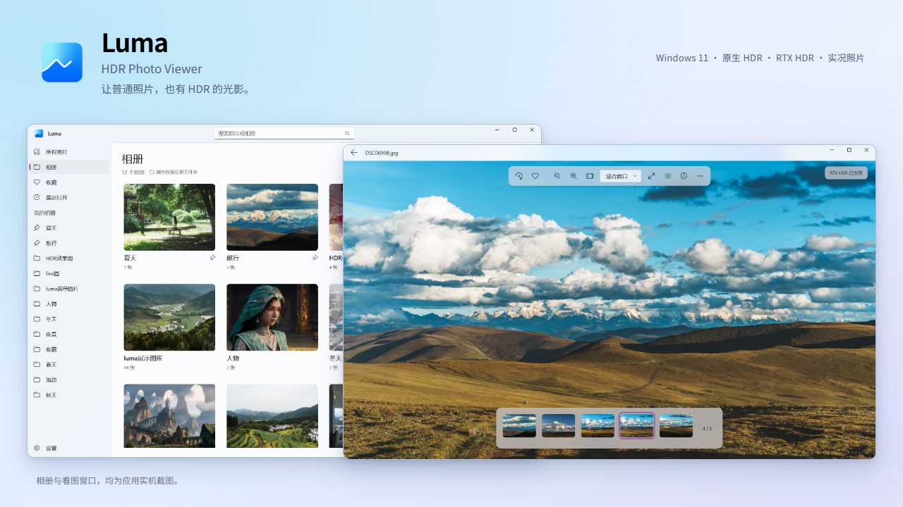

# Luma HDR Photo Viewer

**如果你有一块好 HDR 屏幕，别只用它看电影。也用它，重新看看自己的照片。**



Luma 是免费、开源的 Windows 原生照片查看器，支持**原生 HDR/Live 照片**，也能通过 **NVIDIA RTX Video HDR** 为普通 JPG 带来更丰富的光影，甚至使用HDR预览live照片。

A native Windows photo viewer with RTX HDR, native HDR images, and Live / Motion Photo playback.

[项目主页](https://lueluelue12138.github.io/luma-hdr-photo-viewer/) · [GitHub 下载](https://github.com/lueluelue12138/luma-hdr-photo-viewer/releases/latest) · [夸克网盘下载](https://pan.quark.cn/s/109763c10614) · [HDR 入门](docs/HDR-SETUP.md) · [参与贡献](CONTRIBUTING.md) · [隐私说明](PRIVACY.md)

**当前正式版 `0.1.32` · Windows 11 x64。** [下载安装包](https://github.com/lueluelue12138/luma-hdr-photo-viewer/releases/download/v0.1.32/Luma-0.1.32-windows-x64-rtx-setup.exe)（**58.36 MiB**），或在 [Release 页面](https://github.com/lueluelue12138/luma-hdr-photo-viewer/releases/tag/v0.1.32) 获取便携版（81.86 MiB）与更新说明。国内用户也可使用[夸克网盘下载](https://pan.quark.cn/s/109763c10614)，由维护者手动同步，请按文件夹中的版本号选择。本版新增相册置顶与排序、照片类型多选筛选，并修复图库记录失败遮住正常照片的问题。已安装旧版时，退出 Luma 后直接运行新版安装器即可升级，图库和设置保留。当前包未签名；微软商店版已提交审核，尚未上架。

## 为什么做 Luma

另有独立的 [Luma HDR 转换器](tools/HdrJpeg/README.md)：将 Windows 线性 HDR JXR 截图转换为带 XMP / ISO 增益图的 Ultra HDR JPG，供支持该格式的手机相册查看。当前为本地开发便携版，具体小米 / HyperOS 兼容性等待真机验证。

我有一块很喜欢的 HDR 显示器。看电影时，夕阳、霓虹和明暗之间的层次，经常让我忍不住暂停，把某一帧当成照片欣赏。

可轮到自己拍的照片，体验就没那么顺手了。Windows 的 HDR 生态还不够完整，我一直没找到一个美观、好用、轻便，又能好好利用 HDR 屏幕的照片查看器。

后来，在浏览器里看到 RTX Video HDR 对普通视频的增强效果，我想：自己拍的照片，是不是也能这样欣赏？Luma 就从这个念头开始了——补上 Windows HDR 体验里“看照片”这一块，让好屏幕也用来展示自己的回忆。

## 看图，也顺手

- **照片是主角。** 原生 WinUI 3、深浅主题、悬浮毛玻璃；支持缩放、拖拽和全屏看图。
- **效果由你选择。** HDR 与 VSR 独立控制，VSR 默认关闭；按住空格，对比原图或可用的 SDR 底图。
- **相册顺着你的习惯。** 文件夹导入、搜索、收藏、最近打开；支持相册置顶、相册排序，以及 HDR / 实况 / 普通静态照片多选筛选。照片留在原位置，移除相册不会删除原文件。
- **拍摄细节随手查看。** 顶部信息入口展示日期、相机、镜头、曝光、HDR 来源与实况信息，支持搜索和复制 EXIF；图库角标一眼看出照片特性。

## 让回忆动起来

实况照片里，往往还藏着按下快门前后的声音和动作。Luma 支持完整 iPhone HEIC＋MOV，以及已验证的 Google、Pixel、三星和小米动态照片。点击顶部同心圆图标或按 **L** 播放；首次默认静音，之后会记住你的原声设置。

**动态部分也能选择 RTX HDR 预览。** 按住空格随时对比。请保留 iPhone 配套 MOV，Android 请导出完整原片；聊天软件转发后可能只剩静态图片。原生 HDR 视频和 `.livp` 尚未支持，具体范围见 [Live 照片说明](docs/LIVE-PHOTOS.md)。

## 开始体验 HDR

1. **开启系统 HDR。** 在 Windows“设置 → 系统 → 显示”中选中要用的屏幕，打开“使用 HDR”。
2. **检查屏幕校准。** Luma 设置页可打开微软的 [Windows HDR Calibration](https://apps.microsoft.com/detail/9N7F2SM5D1LR)，未安装时进入商店。按测试图案完成校准并保存配置。
3. **打开自己的照片。** 普通照片在顶部“显示增强”中开启 RTX HDR；已支持的原生 HDR 照片会自动识别，直接显示。

设置页可查看 **Windows 报告的屏幕峰值亮度**，它不是实测值。校准请以图案为准，不照填宣传数字。详细操作见 [HDR 屏幕准备指南](docs/HDR-SETUP.md)。

## 支持范围

| 内容 | 当前支持 |
| --- | --- |
| 普通图片 | JPEG、PNG、BMP、GIF、TIFF、ICO |
| 原生 HDR | iPhone HEIC 的 Apple / ISO 增益图、PQ HEIC；Android Ultra HDR / ISO / Apple 增益图 JPEG；线性 scRGB JPEG XR（JXR / WDP / HDP）。无需 RTX |
| SDR → RTX HDR | 官方 NVIDIA TrueHDR；需要兼容的 RTX 显卡、驱动、含 SDK 的构建与开启 HDR 的屏幕 |
| AI 超分 | 官方 NVIDIA RTX VSR |
| 实况 / 动态照片 | 已验证的 iPhone HEIC＋MOV、Google / Pixel / Samsung / Xiaomi Motion Photo；视频使用 Windows 媒体组件解码，播放期间暂停 VSR |
| 暂未支持 | AVIF HDR、JPEG XL、OpenEXR、RAW、GIF 动画、原生 HDR 动态视频与 `.livp`；HLG HEIC 尚未完成验证。GIF / 多页 TIFF 当前显示第一帧 |

包内包含 .NET、WinUI 和 NVIDIA 运行库，无需另装开发 SDK、FFmpeg 或播放器。HEIC 需要 Windows HEIF 图像扩展和 HEVC 视频扩展，部分实况视频也需要 HEVC 扩展。具体格式、原图对照方式及验证范围见 [HDR 格式说明](docs/HDR-FORMATS.md)。

RTX HDR 是 AI 增强，不能恢复拍摄时没有记录的信息，也不保证每个区域都更亮。大图片可能依据资源预算缩小处理；首次未缓存的大相册缩略图、AI 初始化与更多显示器的适配仍在完善。

>  **让回忆，多一个维度。**
>
> 想换个角度，看看自己的照片？试试我开发的另一个开源项目 **Sharp GUI**，将照片生成可以转动视角欣赏的 3D 空间影像。
>
> **[探索 Sharp GUI ↗](https://github.com/lueluelue12138/sharp-gui)** · 作者的另一个开源项目

## 构建与发布

<details>
<summary>自行构建 Luma</summary>

需要 Windows 11 x64、[.NET SDK 8](https://dotnet.microsoft.com/download/dotnet/8.0)、Visual Studio C++ x64 工具、CMake 与 Windows SDK。准确 SDK 版本见 `global.json`。首次构建会下载并校验固定版本的开放源码 HDR/JPEG 解码器及 NASM，后续复用本地缓存。

```powershell
git clone https://github.com/lueluelue12138/luma-hdr-photo-viewer.git
cd luma-hdr-photo-viewer
./scripts/Build.ps1 -Publish -WithoutNvidia
# 运行 artifacts/Luma/Luma.App.exe
```

此构建支持普通看图与已支持的原生 HDR，**不提供 RTX HDR / VSR**。要使用 NVIDIA 增强，请通过自己的开发者账户取得 [RTX Video SDK](https://developer.nvidia.com/rtx-video-sdk)，按 [SDK 放置说明](external/nvidia/README.md) 准备后运行：

```powershell
./scripts/Build.ps1 -Publish -RequireNvidia
```

完整便携文件夹必须一起保留，不能只复制 EXE。

</details>

GitHub Actions 的 **standard** 开发包不含 NVIDIA SDK。**rtx** 标签流程自动构建 EXE 安装包和便携 ZIP，生成 Release 草稿，核验后再公开。MSIX 使用独立的手动 Store 工作流，配置真实产品标识后出包，不自动上传或提交商店。详见 [发布流程](docs/RELEASING.md) 与 [微软商店操作指南](docs/MICROSOFT-STORE.md)。

图库与设置保存在 `%LOCALAPPDATA%\Luma`，默认图片关联由你在 Windows 设置中选择。

## 一起完善它

欢迎反馈不同 HDR 屏幕、RTX 显卡与大相册的使用体验，也欢迎提出可复现的问题和改进建议。

[待办清单](docs/TODO.md) · [验证记录](docs/VERIFICATION.md) · [开发说明](docs/DEVELOPMENT.md) · [参与贡献](CONTRIBUTING.md)

## 许可

Luma 的原创代码与图标使用 [MIT](LICENSE)，第三方组件适用各自许可，见 [第三方声明](THIRD-PARTY-NOTICES.md)。NVIDIA SDK 与运行库不适用 MIT，不随公开源码提供。

This software contains source code provided by NVIDIA Corporation. Luma is an independent project and is not affiliated with or endorsed by NVIDIA or Microsoft.
