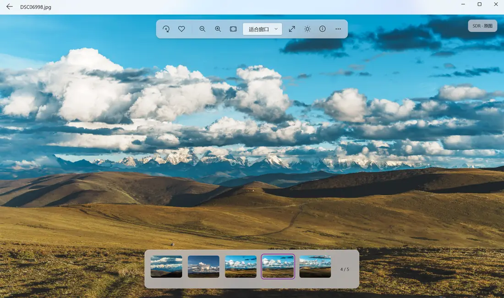
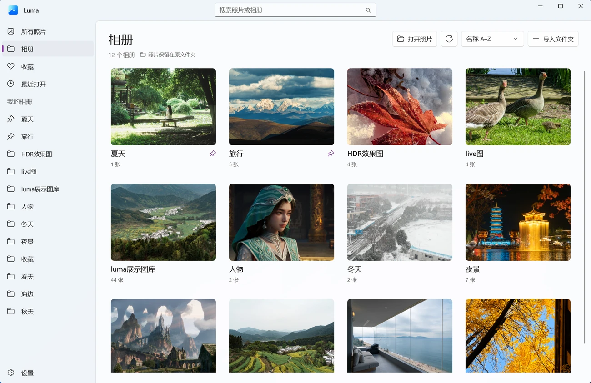

# HDR 显示器买都买了，也让自己的照片享受一下

有了一块不错的 HDR 显示器之后，我看电影时经常会忍不住按暂停。有时剧情先放一边，就想多看看那个画面里的光。

后来我想起自己拍的那些旅行照片。视频里一个好看的镜头，我能停下来欣赏半天；轮到自己的照片，却一直没找到一个看着舒服、用着顺手，还能好好利用 HDR 屏幕的 Windows 看图软件。

所以我自己做了一个，叫 **Luma**。现在免费开源了，想找同样喜欢看照片的人一起试试。

我最喜欢拿雪山照片看。云层、积雪、山坡上的阳光，本来就有很大的明暗反差，用好屏幕重新打开，真的会更愿意停下来多看一会儿。好照片放在硬盘里吃灰，总觉得有点可惜。

普通相机拍的 JPG 也能用上：Luma 接入了 NVIDIA RTX Video HDR，打开照片后就可以选择增强。按住空格看原图，松开恢复效果，自己对比、自己决定喜欢哪种。它是 AI 增强，每张照片效果会有差别。

如果照片本来就带 HDR，像 iPhone 的 HDR HEIC、Android Ultra HDR，或者 Windows 的 JXR 截图，会走已支持的原生 HDR 路径。还有一个我很想做的功能：**让实况照片动起来看，动态部分也能选择 RTX HDR。** iPhone 的照片和 MOV 要一起保留，Android 也要尽量传完整原片，聊天软件有时只会留下静态照片。

日常看图这部分我也想做得顺手一点。文件夹导入就是相册，照片还放在原来的位置；常看的相册可以置顶，HDR 和实况照片可以筛选。界面用 WinUI 3 做，支持深浅主题、全屏，工具栏悬浮在照片上，需要的时候再展开拍摄信息。

试之前先提醒一句：要看 HDR 效果，记得打开 **Windows HDR**，也建议跑一遍微软的 HDR 校准。RTX 增强需要兼容的 NVIDIA RTX 显卡和驱动；HEIC 和部分实况视频可能还需要 Windows 的 HEIF / HEVC 扩展。普通截图很难把屏幕上的亮度差异传出来，最直接的办法还是装上以后，用自己的照片看看。

目前正式版是 **0.1.31**，Windows 11 x64，安装包约 **58.42 MiB**。安装包里带了运行环境，不需要装开发 SDK 或另找播放器。还有不少地方想继续完善，遇到问题或者有好建议，都欢迎来提。

如果你也有一块喜欢的 HDR 屏幕，找张自己最喜欢的照片试一下。尤其是雪山，我真觉得值得重新看一遍。

[项目主页](https://lueluelue12138.github.io/luma-hdr-photo-viewer/) · [下载最新版](https://github.com/lueluelue12138/luma-hdr-photo-viewer/releases/latest) · [GitHub 源码与反馈](https://github.com/lueluelue12138/luma-hdr-photo-viewer)
